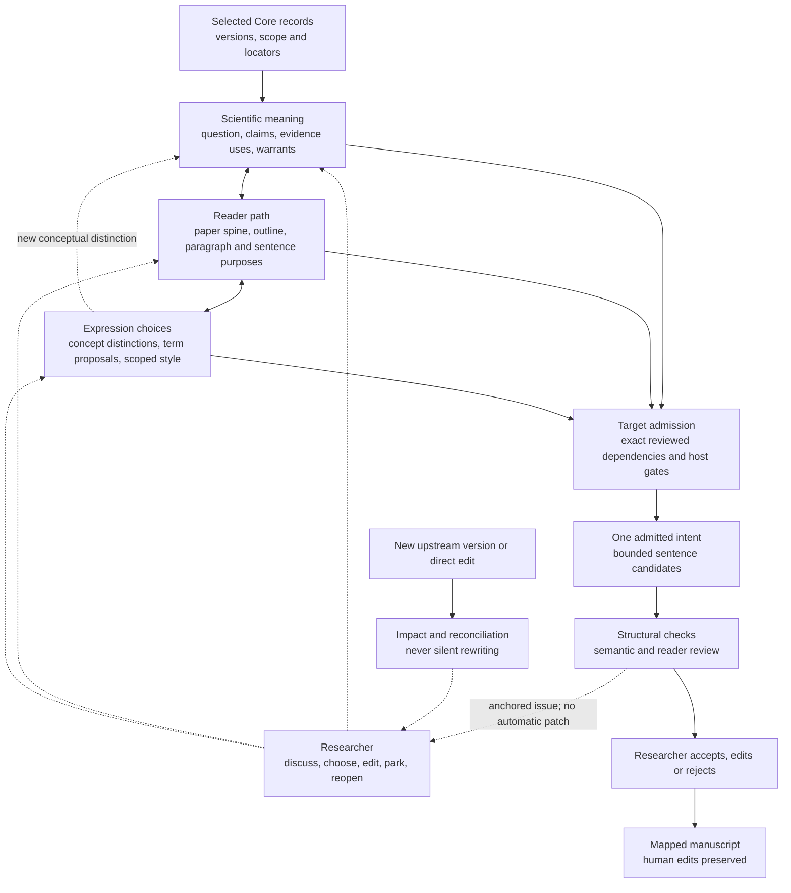

# Writer Framework: Researcher Decisions Before Prose

- Status: Working synthesis; proposed refinements under accepted ADR 0008
- Reviewed: 2026-09-14
- Scope: design and validation, not implementation authorization
- PI scope record: `jrn_01M2GMBXSFMASNFEYK9F1H866B`
- Source analysis: [observations and evidence](../research/2026-09-14-writing-workflow-observations.md)
- Operational detail: [language and revision protocol](language-and-revision-protocol.md)

## Product definition

Writer helps a researcher decide what a paper can responsibly say, what its
reader must understand, and how that approved meaning should be expressed.
Its Authoring Graph preserves those decisions; its interface makes the next
consequential question understandable. The model proposes, the researcher
commits meaning, and the coordinator enforces bounded state changes.

The essential deliverable is not more prose. It is a defensible argument that
the author understands, can express in their own voice, and can revise without
losing control of previously settled meaning.

This consolidates the existing three-loop design. It does not replace it with
a new ten-stage wizard, a general editor, or a collection of autonomous agents.
"Compiler" is an authority/traceability analogy, not a claim that natural-
language generation or semantic equivalence can be proved deterministically.

## What is settled, observed, and still proposed

| Category | Current standing |
|---|---|
| Accepted product boundaries | Core/Writer/document separation; researcher-owned meaning; one admitted intent per candidate set; no silent rewrite; preserved human edits; subscription-included-only execution |
| Accepted interaction direction | Paper-centered views; useful discussion and exact approval bundles; local readiness with global awareness; explicit consent to generalize style |
| Observed implementation | Supplied-text W0 mock and engineering checks; not a supported authoring runtime or observed human study |
| Proposed in this synthesis | Operational term proposals, issue-to-layer routing, semantic-change accounting, minimum language-quality cases, task-specific stopping criteria |
| Not established | Better scientific fidelity, lower author burden, successful style transfer, sufficient host billing/isolation guarantees |

ADR 0008 governs conflicts with earlier design-freeze, fixed-layout or style
commitments. A PI request to improve design documents authorizes this work;
it does not ratify every new protocol or turn an observation into a result.

## Three authority domains

| Domain | Owns | Does not imply |
|---|---|---|
| RKA Core | Research sources, observations, results, reviewed claims/scopes, research decisions and their provenance | A source is selected for a particular sentence, or its conclusion is scientifically certain |
| Writer | Paper-specific claim selection, Evidence Uses and warrants, reader path, concept/term decisions, style preferences, approvals and revision history | A second authoritative experiment database or permission to rewrite Core |
| Document | Actual Markdown/LaTeX bytes, human edits, rendered output and synchronization state | Every human edit has already been reconciled with the Authoring Graph |

Core references retain exact identities, versions and locators. A Writer
Evidence Use states what part of a source supports which proposition and under
which limits. A copied citation key is neither that selection nor support.
Pinned local snapshots are caches with visible age, not competing truth stores.

The RKA development project may store research *about Writer*, including this
design synthesis. That does not authorize the future Writer runtime to upload
users' drafts, style profiles or incidental review conversations to Core.

## One paper, three connected decision loops

### Scientific meaning: what may this paper claim?

Start with a provisional central question, not a polished introduction. Retrieve
relevant Core evidence, including qualifiers and counterevidence, and compare
claims and alternative framings. Each alternative exposes its unit of analysis,
evidence burden, audience and prohibited extensions. Do not merge attractive
fragments into a broader claim without reviewing the resulting burden.

The local commitment is a paper question, bounded claim portfolio and selected
Evidence Uses. A support gap leads to narrowing, an explicit research question,
or a parked branch. It cannot be repaired by adding confident or cautious prose.

### Reader path: what must a reader understand, and when?

Construct a Paper Spine, section roles, paragraph allocation and sentence-intent
plan. A paragraph contract records the reader's entry knowledge, question,
intended takeaway, evidence/reasoning obligations and what the next unit can
now assume. Record order in Core is not narrative order in the paper.

Sentence functions expose reasoning; they are not a compulsory C–E–W–T pattern.
A sentence may serve a primary and secondary function within one approved
intent. Definitions, transitions and limitations need appropriate justification,
not invented experiments merely to satisfy a universal evidence field.

The local commitment is a readable plan in the context of the whole paper.
The author may approve coupled paragraph-purpose and intent changes together;
the approval does not include future candidate text.

### Expression: how should this meaning be stated?

Clarify concepts early; use provisional labels while comparing meanings. Before
realization, select the exact needed terms through a reviewable term proposal.
Concept identity and scope outrank preferred vocabulary. A new label that
changes the unit of analysis returns to the scientific loop.

Style can start from direct preferences or optional selected samples. Extract
grounded observations, not an opaque inferred identity. After admission, compare
expressions of the same meaning. Accepting an edit and adopting a section/paper
style rule are distinct decisions. An empty explicitly chosen profile is valid.

## Four granularities and a useful next question

| Concern | Unit |
|---|---|
| Storage | Individual versioned records and links |
| Discussion | One consequential question, including coupled choices |
| Approval | Exact displayed versions, scope, exclusions and impact |
| Generation | One admitted sentence intent and its small candidate set |

The next-question policy should prioritize material contradictions, absent
support and scope before polishing. It explains why a decision matters, what
information is missing and which work can continue without it. The author can
change focus, supply their own wording, reject the framing or park a branch.

Do not maximize rounds, clicks, lock counts or agreement. Measure whether an
interaction changes the author's understanding or settles a consequential
uncertainty. Discuss multiple related fields naturally; only then show the
compact, exact commitment preview. Do not ask again for already approved bases.

## Quality checks before and after prose

| Checkpoint | Inspect | Possible action |
|---|---|---|
| Before commitment | Claim/evidence fit, missing warrant, conceptual distinctions, reader need | Ask the researcher; revise a proposal; park unsupported work |
| Before generation | Ready exact dependencies, intent/function, term locks, applicable style and execution gates | Admit only the target; explain blockers |
| After generation | Scope, citation support, numerical meaning, term identity, information order and reader burden | Anchored finding, pass/no change, or bounded patch proposal |
| After upstream/direct change | Consumed dependencies, manuscript expression and mapping | Revalidate, revise, remap or retire explicitly; preserve old bytes |

The logical roles are Mentor, Realizer and reviewer, not necessarily different
models or processes. Independent evidence, deterministic checks and human
judgment matter more than agent count. A role prompt alone is not isolation.

"AI-tics" is an informal symptom category, never an authorship detector or
quality score. Audit concrete information loss, unsupported emphasis, conceptual
drift, unnecessary repetition and reader burden. A technical repetition,
well-supported adjective, useful transition or necessary hedge may be correct.
No finding and no change are legitimate successful outcomes.

See the [operational protocol](language-and-revision-protocol.md) for term
proposal fields, review outputs, semantic-change reports and stopping rules.

## Convergence without premature closure

A target is provisionally settled when its required meaning and terminology
are approved, material support/scope issues are resolved, the reader can recover
the intended takeaway, and the author accepts the expression. This is not a
permanent ban on revision or a requirement that all other sections be finished.

Reopening has a reason: new evidence, a corrected assumption, a conceptual
distinction, a reader misunderstanding, an author preference or system drift.
Keep these causes separate. Do not score a scientifically justified pivot as
failure just because it invalidates many downstream artifacts.

Each patch needs an identified defect and observable acceptance condition.
If the same issue returns, the process should diagnose the upstream contract
instead of proposing endless polish. The report's "two failed cycles" can be
tested as a warning heuristic, not a universal hard cutoff. Stop when the
identified defect is resolved; do not require a model to invent another edit.

## Minimum logical records

Retain the existing Authoring Graph. The proposed protocols elaborate its
records rather than demanding new tables or services:

- scientific commitments: question, publication claims, Evidence Uses/warrants;
- discourse commitments: Paper Spine, outline, paragraph and intent plans;
- expression commitments: concept entries, term proposals/locks, scoped style;
- review and change records: anchored issues, selected patch scope, semantic
  delta, approvals, impact dispositions and source-map reconciliation;
- source and operational references: locators, manifests, runtime observations
  and recoverable document snapshots.

An issue does not become a command because a critic produced it. A term proposal
does not become a lock because its examples sound convincing. A dependency
graph does not verify entailment. These are separate transitions to test.

## Smallest useful validation

Keep W0 manual/supplied-text and W1 one paragraph in a paper. Add the
[language and convergence cases](../evaluation/w0-language-and-convergence-cases.md)
to the existing walkthrough instead of building a full Style Lab.

Test a confusing term distinction, a genuine clarity defect, a harmless
"AI-looking" sentence, a necessary qualification, a declined style promotion,
a changed upstream condition and a valid no-change outcome. Compare with a
competent document-plus-contextual-chat workflow using the same evidence.

Measure scientific errors and false alarms separately from author preference,
reader comprehension, interaction effort and accidental versus justified
reopening. Broader efficacy claims require more than a single walkthrough.

W0/W1 status, provider-host qualification and implementation authority remain
unchanged. Core embedding maintenance is operational infrastructure work; a
successful backfill does not validate any Writer design hypothesis.

## Navigation and maintenance

- [RFC 0001](../rfcs/0001-authoring-ir-and-convergence-protocol.md): authoring
  state, admission, dependency effects and recovery.
- [RFC 0002](../rfcs/0002-subscription-host-and-paper-studio.md): interaction
  and independent subscription/billing/isolation gates.
- [RFC 0003](../rfcs/0003-researcher-owned-style-profile.md): style sources,
  calibration, scope and copy-risk controls.
- [Source observations](../research/2026-09-14-writing-workflow-observations.md):
  report locators, empirical qualifications and corrected old interpretation.
- [RKA record index](../research/writer-rka-index.md): exact current decisions,
  this consolidation's records and historical caveats.

Future changes should update the relevant protocol and this entry point, append
the source observation/reason in RKA, and explicitly mark replaced interpretations.
Do not accumulate disconnected summaries or silently overwrite PI directives.
